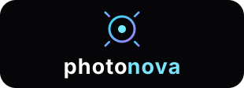

<p align="center"></p>

# Photonova

**Learn optical wireless by playing with light.** Open, interactive 3D courseware for optical wireless communications, from zero to hero.

Photonova teaches visible light communication (VLC), LiFi, optical camera communication (OCC), free-space optics (FSO) and underwater optical links (UWOC). Each equation comes with a 3D scene or a live simulation you can change and break. The content follows the field's surveys, tutorials, handbooks and standards, and every lesson cites its sources.

## What's inside

| | |
| --- | --- |
| **32 lessons** in 8 tracks | Foundations → Transmitters → Channel → Receivers → Modulation & Coding → Receiver DSP → Systems & Networks → Research Frontiers, including LOS/NLOS geometry, surfaces and diffusion, channel impairments, lens systems, a receiver zoo, channel coding with an LDPC decoder, line codes (Manchester, Miller, 4B6B, VPPM), optical components (splitters, polarizers, wave plates, isolators), multiple access (TDMA, FDMA, OFDMA, OCDMA, SDMA, WDMA, NOMA, CSMA/CA), quantum key distribution and entanglement, smart surfaces (RIS, metasurfaces, MEMS, DMDs, liquid crystals) and neural-network equalisers |
| **37 interactive figures** | LED physics in 3D, a Lambertian room, multipath, photon-by-photon absorption/scattering/turbulence/scintillation, BRDF lobes, 2D receiver-optics ray tracing (lens, Fresnel, hemisphere, CPC), animated detector cut-aways (PIN, APD, SPAD, SiPM, PMT, CMOS, solar, LED), a Hamming Venn-diagram decoder with coded-BER curves, an MLP equaliser trained in the browser, an LDPC Tanner-graph decoder, a Mueller-calculus polarization rail, a BB84 and Bell-test simulator, a multiple-access resource view with a NOMA rate region, a reconfigurable-surface beam steerer, and more |
| **Optical Bench** | A 3D lab: choose a scenario (office, NLOS corridor, optical table, screen-to-camera, street V2X, building FSO, underwater, satellite-to-satellite, sandbox), place 35 kinds of component (LEDs, lasers, street lamps, screens; PIN, APD, SPAD, SiPM, PMT, InGaAs, camera, solar cell; mirrors, curved mirrors, retroreflectors, prisms, lenses, diffusers, polarizers, filters, splitters, RIS; walls, people, cars) and get ray tracing, impulse response, link budget, SNR, BER before and after FEC and throughput for any modem chain, plus an advisor that diagnoses the link and recommends a complete design |
| **System view** | The whole VLC/LiFi link as a 3D object: 19 blocks from data source to sink, each with its job, variants, key equation and the signal at that point |
| **Use cases** | 13 animated 3D scenes: LiFi office, vehicles and smart streets, satellite laser links, ground-to-space, underwater networks, TV-to-phone, display-to-display, indoor positioning, building-to-building FSO, aircraft cabin, industrial wireless, drone relays, battery-free retroreflective tags |
| **Link Lab** | An end-to-end IM/DD waveform simulator with eye diagrams, constellations, spectra and BER |
| **Library** | 92 curated references (IEEE COMST surveys, tutorials, handbooks, landmark papers, standards), each DOI checked against Crossref |
| **Engines** | Plain TypeScript in `src/sim/` and `src/bench/`, deterministic and unit-tested (46 tests) |

## Quick start

```bash
npm install
npm run dev          # http://localhost:5173
npm test             # simulation unit tests
npm run build        # static site in dist/ (GitHub Pages or any static host)
npm run build:single # one self-contained HTML file in dist-single/
```

Requires Node.js 18 or newer.

## Project layout

```
src/
├─ content/                 ← everything a learner reads
│  ├─ tracks.ts             curriculum tracks (each tagged with a wavelength)
│  ├─ references.ts         bibliography (cited by id)
│  ├─ glossary.ts           terms and acronyms
│  ├─ registry.ts           auto-discovers lessons
│  └─ lessons/<track>/<lesson>/
│     ├─ meta.ts            title, level, prerequisites, objectives, references
│     └─ lesson.mdx         Markdown + LaTeX + interactive figures
├─ sim/                     physics & DSP (pure TS, unit-tested)
├─ widgets/                 interactive figures, registered in widgets/index.ts
├─ three/                   shared 3D stage, hero scene, colour maps
├─ viz/                     canvas plotting and controls
├─ mdx/                     components available inside lessons
├─ bench/                   Optical Bench: catalog, scenarios, ray tracer, link engine, advisor, 3D UI
├─ arch/                    3D system view: blocks and the signal chain they display
├─ usecases/                use-case catalogue and their 3D scenes
├─ pages/ · shell/          app pages and chrome
```

See [docs/ARCHITECTURE.md](docs/ARCHITECTURE.md) for how the pieces fit and [CONTRIBUTING.md](CONTRIBUTING.md) to add a lesson, a figure or a reference.

## Adding a lesson in one minute

```bash
npm run new:lesson -- channel my-new-topic "My new topic"
```

Edit `src/content/lessons/channel/my-new-topic/lesson.mdx`. It appears in the curriculum, search and navigation automatically.

## Deploying

`.github/workflows/pages.yml` builds and publishes to GitHub Pages on every push to `main`. In the repository settings, set **Pages → Source** to **GitHub Actions**. Set the repository URL as `VITE_REPO_URL` (the workflow does this automatically) so the app links back to the source.

## Licence

- Code: [MIT](LICENSE)
- Lesson text and figures: [CC BY 4.0](CONTENT_LICENSE.md)

Cited works belong to their authors and publishers; Photonova links to them and quotes nothing beyond short attributed facts.
